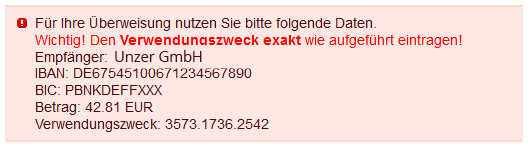

Die Überweisungsdaten können über das Bestellobjekt abgerufen werden, beispielsweise für eine PDF-Rechnung oder die Anbindung einer Warenwirtschaft. Der Getter unterstützt Vorkasse, gesicherten und ungesicherten Rechnungskauf, B2B-Rechnungskauf sowie PayLater-Rechnungskauf. PayLater-Lastschrift wird ausgeschlossen, da der Betrag eingezogen wird.

```php
/** @var \D3\Unzer\Modules\Application\Model\Order $order */
$order = oxNew(\OxidEsales\Eshop\Application\Model\Order::class);
$order->load('OxidDerBestellung');

$bankTransferData = $order->getUnzerBankTransferData();
var_dump($bankTransferData);
/* Beispiel eines MGW-Ergebnisses:
array (
    'holder' => 'Unzer (GmbH)',
    'iban' => 'DE89370400440532013000',
    'bic' => 'COBADEFFXXX',
    'formattedAmount' => '33,80',
    'currency' => 'EUR',
    'descriptor' => 'REFERENCE-123',
    'paymentReference' => '',
    // Weitere Transaktionsinformationen können enthalten sein.
)
*/
```

Bei der MGW-Schnittstelle werden zuerst die Daten der Autorisierung geprüft. Fehlen IBAN, Kontoinhaber oder eine Zahlungsreferenz, wird die erste Charge mit vollständigen Überweisungsdaten verwendet. Eine BIC ist nicht zwingend erforderlich. Als Verwendungszweck wird `descriptor` verwendet; alternativ kann `paymentReference` vorliegen.

Bei unvollständigen oder noch nicht verfügbaren MGW-Daten sowie bei einem abgefangenen Unzer-API-Fehler wird ein leeres Array zurückgegeben. Bei inaktivem Modul, nicht unterstützter Zahlungsart oder ungültiger Payment-ID liefert die Methode `false`. Die bisherige NGW-Verarbeitung liefert weiterhin ein Objekt oder `null`.

Der bisherige Methodenname `getHeidelpayBankTransferData()` bleibt als veraltete Weiterleitung auf `getUnzerBankTransferData()` verfügbar. Verwenden Sie für neue Anpassungen den Unzer-Namen.

Ein Anwendungsbeispiel wird dem Kunden bereits auf der "Thank You" Seite angezeigt:

